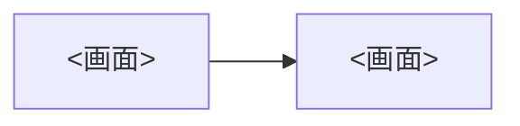

# 画面例

<!-- Replace every <...> placeholder. verify-screens.sh reads the rows that start with | `NN-name.png` |. -->

<製品名> の画面例です。要件を関係者と擦り合わせるための**たたき台**であり、画面例にある項目・操作は合意済みの要件ではありません。

| 項目 | 内容 |
| --- | --- |
| 対象 | <要件書へのリンク> の要件 No. <最初>〜<最後> |
| 基準端末 | スマートフォン縦向き 390×844。PNG は 2 倍の 780×1688 |
| 枠組み | 部品は A2UI v0.9.1 の基本カタログ、見た目は Material 3。詳細は <DESIGN.md へのリンク> |
| 作成日 | <YYYY 年 M 月 D 日> |

## ファイル

| パス | 内容 |
| --- | --- |
| `src/index.html` | 入口。ブラウザで直接開く |
| `src/styles.css` | デザイントークンと部品の見た目。値は DESIGN.md と揃える |
| `src/app.js` | 部品の関数、架空のデータ、各画面、画面の登録表 `SCREENS` |
| `src/vendor/` | 書体とアイコンのフォント。画面で使う文字とアイコンだけを含む |
| `src/capture.sh` | 登録表の全画面を PNG に書き出す |
| `src/fetch-assets.sh` | `src/vendor/` のフォントを取り直す |
| `src/font.conf` | 書体名と太さ。`src/styles.css` の `--font-plain` と揃える |

## 開き方と書き出し方

```sh
open <screens-dir>/src/index.html          # viewer: screen list + phone frame
<screens-dir>/src/fetch-assets.sh           # after adding text or icons
<screens-dir>/src/capture.sh                # export every screen
```

## 画面を直すとき

| したいこと | 直す場所 |
| --- | --- |
| 色・角丸・文字サイズ | DESIGN.md を先に直し、`src/styles.css` の `:root` を揃える |
| 画面の中身 | `src/app.js` の `S["<画面 ID>"]` |
| 画面を足す | `S` に描画関数を足し、`SCREENS` に 1 行足す |
| 新しい文言・アイコン | `src/fetch-assets.sh` を実行してから書き出す |

共通の枠（ナビゲーションバー、アプリバー、CSS）を変えたら、一部ではなく全画面を書き出し直します。PNG は直接編集しません。

## 画面一覧

| PNG | 画面 | 主な要件 No. |
| --- | --- | --- |
| `01-<name>.png` | <画面の説明> | <001、002> |

## 画面の流れ



## 未決の点

画面例では仮の形で描いています。確定は確認事項の回答を待ちます。

| 画面 | 仮に描いたもの | 確認事項 |
| --- | --- | --- |
| すべて | スマートフォン縦向きだけを描いた | <番号> |

## 注意点

- 人名・場所の名前・住所・電話番号・金額はすべて架空です。
- 写真は図形で描いた仮の画像です。
- 画面内に要件 No.・要求 No. は表示しません。対応は上の表で示します。
- 画面例は 1 画面に収まる範囲だけを描いています。下にある項目はスクロールして表示する想定です。
